<h1 align="center">Hey  I'm Riccardo Niccolò Agosti</h1>

## 📌 About Me
- 🧠 **Data Scientist & AI Engineer** at **Leithà** (Unipol Group): LLM agents, RAG, Document AI and LLM evaluation.
- 🎓 MSc in Data Science, University of Padova · BSc in Statistics, University of Florence.
- 🔬 Into **statistically honest LLM evaluation**: exact-match scoring, bootstrap CIs, McNemar + Holm.
- 🛠️ Side project: [**vibeboard**](https://github.com/ricca200xx/vibeboard), an infinite canvas of real terminals to orchestrate CLI coding agents.
- 🌐 More about me: [riccardo-niccolo-agosti.com](https://www.riccardo-niccolo-agosti.com/)

## 📊 GitHub Stats

  
  

  

## 🚀 Featured Projects

| Project | What it does | Stack |
| --- | --- | --- |
| [vibeboard](https://github.com/ricca200xx/vibeboard) | Infinite canvas of real terminals to run Claude Code, Codex, Gemini side by side | TypeScript |
| [llm-doc-extraction-eval](https://github.com/ricca200xx/llm-doc-extraction-eval) | Strict evaluation of LLM/VLM receipt extraction on CORD-v2, hallucinations counted as FP | Python · LiteLLM |
| [Autonomous Highway Driving](https://github.com/ricca200xx/Autonomous-Highway-Driving-with-Deep-Q-Learning) | DQN agent for multi-lane highways, benchmarked against heuristic and human baselines | Python · RL |
| [Pokémon Detection](https://github.com/ricca200xx/Pokemon-Detection-Model-Comparison) | YOLOv11s vs RT-DETR vs Faster R-CNN for real-time detection | Python · CV |
| [Weather Seq2Seq GRU](https://github.com/ricca200xx/Weather-Time-Series-Forecasting-with-Seq2Seq-GRU) | 76 weather variables, 30 steps ahead, teacher forcing + noise injection | PyTorch |
| [Maximum Clique](https://github.com/ricca200xx/Find-a-maximal-clique-with-optimization-algorithm) | Max-clique via Projected Gradient Descent and Frank-Wolfe variants | Python · Optimization |

## 🛠️ Languages & Tools

### AI & Machine Learning

  
  
  
  
  
  
  
  
  <picture>
    <source media="(prefers-color-scheme: dark)" srcset="https://cdn.simpleicons.org/langchain/white" />
    
  </picture>

### Programming Languages

  
  
  
  
  
  
  

### Frontend

  
  <picture>
    <source media="(prefers-color-scheme: dark)" srcset="https://cdn.simpleicons.org/nextdotjs/white" />
    
  </picture>
  
  
  
  

### Backend

  
  <picture>
    <source media="(prefers-color-scheme: dark)" srcset="https://cdn.simpleicons.org/express/white" />
    
  </picture>

### Database

  
  
  
  
  

### DevOps & Cloud

  
  
  
  
  
  

### Tools

  
  
  
  
  
  

## 🔗 Connect with Me

  
  

<picture>
  <source media="(prefers-color-scheme: dark)" srcset="https://raw.githubusercontent.com/ricca200xx/ricca200xx/output/github-snake-dark.svg" />
  <source media="(prefers-color-scheme: light)" srcset="https://raw.githubusercontent.com/ricca200xx/ricca200xx/output/github-snake.svg" />
  
</picture>

Riccardo Niccolò Agosti · <a href="https://www.gitskins.com/readme-generator?template=community-creative-dev-rt3x">creative dev</a> template by <a href="https://www.gitskins.com/creators/himanshu201031">@himanshu201031</a> · generated with <a href="https://www.gitskins.com/readme-generator">GitSkins</a>

